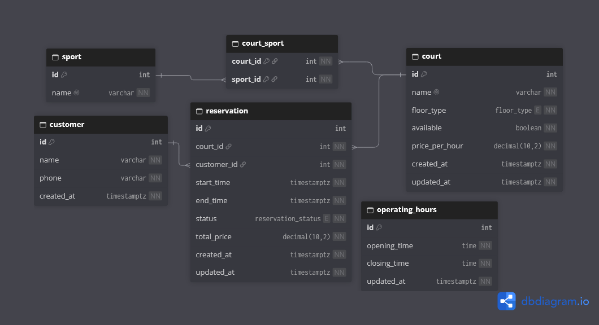

# Reserva de Quadras

Sistema full stack para gerenciamento e reserva de quadras esportivas, processo que costuma ser feito manualmente por WhatsApp ou caderno.

## Status

Modelagem inicial do banco de dados — Sujeito a mudanças durante desenvolvimento

Em desenvolvimento — fase inicial de planejamento.

## Tecnologias

- Backend: Java e Spring Boot
- Frontend: Angular
- Banco de dados: PostgreSQL

## Funcionalidades planejadas

- Cadastro e gerenciamento de quadras e modalidades 
- Consulta de horários disponíveis
- Reserva de horários com prevenção de conflitos
- Cancelamento de reservas

## Modelagem do Banco de Dados

- [Consultar código-fonte (DBML)](docs/database/database_schema.dbml)
